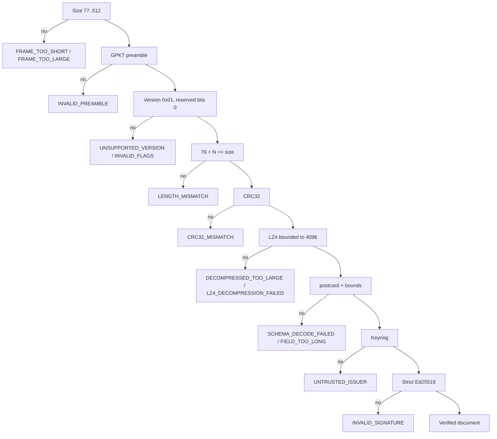

# Design — GPKT binary protocol

## Layout
```text
Offset   Size     Field              Value
0        4        Sync               0x47 0x50 0x4B 0x54 ("GPKT")
4        1        Version            0x01
5        1        Flags              b0 LZ4 | b1 FSK | b2 FOUNTAIN | b3 DEMO | b4..b7 = 0
6        2        Length N           u16 BE, 1 ≤ N ≤ 436
8        N        Payload            postcard(GhostDocument), LZ4 if b0
8+N      4        CRC32              u32 BE, crc32fast(frame[0..8+N])
12+N     64       Signature          Ed25519(frame[0..12+N])
Total    76 + N ≤ 512
```

LZ4 payload (if b0): `[decompressed size u32 LE][LZ4 block]`.

## Document
```rust
struct GhostDocument {
    doc_id: [u8; 8],
    timestamp: u64,          // epoch seconds, supplied by the caller
    issuer_pubkey: [u8; 32], // filled in by the encoder
    body: DocumentBody,      // discriminant = doc_type
}
enum DocumentBody {
    TontineReceipt { group, member, collector, amount_minor: u64, currency, cycle: u16, note },        // 0x01
    MedicalPrescription { clinic, practitioner, patient_ref, items: Vec<{drug, dosage, days}>, note }, // 0x02
    EmergencyVoucher { program, distributor, beneficiary_ref, items: Vec<{label, quantity, unit}>, valid_until: u64, note }, // 0x03
}
```
Bounds: fields ≤ 64 B, `currency` ≤ 8 B, `unit` ≤ 16 B, `note` ≤ 120 B, `items` ≤ 8.

## Measured sizes (presets, `cargo test --test protocol_vectors -- --nocapture`)
| Preset | postcard | Payload | Frame |
|---|---|---|---|
| Dakar Tontine Receipt | 220 B | 220 B | 296 B |
| Ndiob Rural Clinic Prescription | 274 B | 274 B | 350 B |
| Kaolack Flood Relief Voucher | 235 B | 235 B | 311 B |

`postcard` is already compact: on these short, varied texts LZ4 gains nothing, so the encoder keeps the raw payload (b0 = 0). LZ4 turns on by itself for repetitive documents.

## Verification sequence


## Decisions
- **CRC32 before the signature**: channel noise yields `CRC32_MISMATCH`, which says more than `INVALID_SIGNATURE`, and skips a useless Ed25519 check.
- **Signature covers the CRC32**: an attacker who edits the payload and recomputes the CRC32 hits `INVALID_SIGNATURE` (test `resigned_content_with_recomputed_crc_is_still_rejected`).
- **`verify_strict`**: rejects small-order keys and malleable signatures.
- **No randomness in the crate**: the seed comes from the caller.

## WASM API
| Function | Returns |
|---|---|
| `key_info(seed)` | `{ publicKeyHex, fingerprint }` |
| `encode_document(draft, seed, flags)` | metadata + `frame: Uint8Array` |
| `decode_frame(frame, trustedHex[])` | `VerifiedFrame` or `{ code, message }` |
| `inspect_frame(frame)` | `{ fields[], ok, errorCode, errorMessage }` |
| `flip_bit(frame, byte, bit)` | altered copy |
