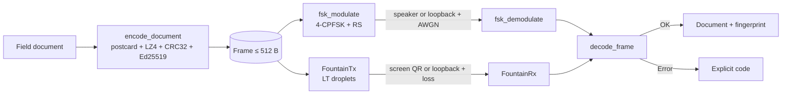
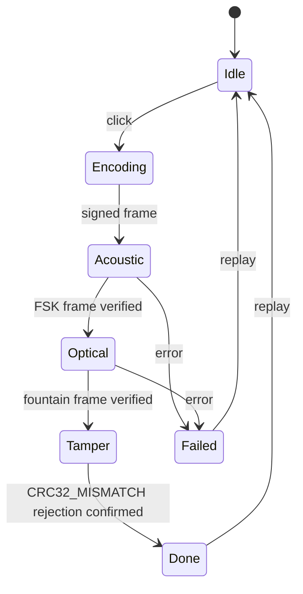

# Design — GhostPacket core system

## Overview
The system is a static web app. All business logic runs in a WebAssembly module compiled from `crates/ghostpacket-core`. The browser only does hardware I/O and rendering.

## Components
| Component | Location | Role |
|---|---|---|
| `protocol` | `crates/ghostpacket-core/src/protocol.rs` | GPKT frame, ordered verification, inspection |
| `schema` | `src/schema.rs` | 3 document types, field bounds |
| `crypto` | `src/crypto.rs` | Ed25519 from seed, fingerprint |
| `fec` | `src/fec.rs` | Reed-Solomon GF(256) |
| `fsk` | `src/fsk.rs` | Acoustic modem + FFT spectrum |
| `fountain` | `src/fountain.rs` | LT codes + decoder |
| `channel_sim` | `src/channel_sim.rs` | Deterministic noise, loss, bit flip |
| `wasm-bridge` | `web/src/lib/wasm-bridge.ts` | Only WASM import point, timing |
| `audio-engine` | `web/src/lib/audio-engine.ts` | Loopback, speaker, microphone |
| `optical-engine` | `web/src/lib/optical-engine.ts` | QR rendering, loopback, camera |
| `demo-runner` | `web/src/lib/demo-runner.ts` | 1-click scenario |

## 1-click demo state machine

## Error handling
- Rust: `Result<T, GhostError>` everywhere, no panic (`panic = "abort"` in release).
- WASM boundary: every error becomes `{ code, message }`.
- UI: a rejection is a normal result shown in red, never an unhandled exception.

## Fallback (US-04)
| Situation | Behaviour |
|---|---|
| Microphone denied | Virtual acoustic loopback, banner "Microphone unavailable: switched to the virtual loopback" |
| Camera denied | Virtual optical loopback |
| `BarcodeDetector` missing | `jsQR` on the video pixels |
| `AudioContext` suspended | Demodulation on the synthesized PCM, no playback |

## Security
- Signing key: 32 bytes from `crypto.getRandomValues`, session memory only.
- The document carries the issuer's public key, covered by the signature.
- Optional trusted keyring: if non-empty, a missing key gives `UNTRUSTED_ISSUER`.

## Test strategy
| Level | File | Hook |
|---|---|---|
| Unit | `#[cfg(test)]` modules | `fuzz-noise-channel` (compilation) |
| Protocol vectors | `tests/protocol_vectors.rs` | `kiroween-audit --full` |
| Acoustic fuzz (noise, drift, echo) | `tests/noise_fsk_fuzz.rs` | `fuzz-noise-channel` |
| Optical fuzz | `tests/optical_fountain_fuzz.rs` | `fuzz-noise-channel` |
| TS types | `tsc --noEmit` | `ts-typecheck-on-save` |
| Browser E2E | headless Chrome, fake mic and camera | manual (see `judge-demo-ui/design.md`) |
