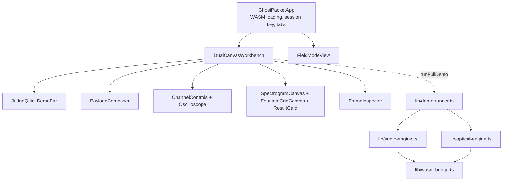

# Design — Judge demo UI

## Components

## Data flow
- Audio ticks (one 1024-sample window per animation frame) go straight to the canvases through a `ref` (`SignalSink.push`), never through React state.
- Optical ticks update React state (≤ 20 per second).
- `wasm-bridge` times every call in a per-operation buffer. The KPIs show the median encode and verify times.

## Acoustic loopback
1. `fsk_modulate` in fast mode at 48 kHz, with 250 ms of silence before and 150 ms after.
2. `inject_awgn` adds noise referenced to the tone level, as in the fuzz tests.
3. Playback runs in real time. The clock is the `AudioContext` clock if sound is played, `performance.now` otherwise.
4. Every 250 ms the receiver demodulates what it has "heard". `FSK_INCOMPLETE` turns on `SYNC LOCK`.
5. At the end of the burst, full demodulation is followed by `decode_frame`.

## Optical loopback
For each image:
1. `FountainTx.droplet(seed)` is converted to hexadecimal and the QR code is drawn on the emitter canvas.
2. `is_dropped` decides whether the image is lost. Otherwise `jsQR` reads the canvas pixels and the result goes to `FountainRx.ingest`.
3. The loop stops as soon as the frame is complete (at most 10K images).

## Measured times (headless Chrome, tontine preset, default settings)
| Step | Duration |
|---|---|
| Signing | 0.5 s (display pause included) |
| 4-FSK sound | ≈ 9 s (8.1 s burst) |
| QR, 30 % loss, 12 FPS | ≈ 3–5 s |
| Curse + end | ≈ 0.5 s |
| **Total** | **≈ 14–16 s** |

## Field mode validation (headless Chrome, fake devices)
| Path | Input | Result |
|---|---|---|
| Microphone | robust burst of the prescription, 100 ppm drift, 2 echoes, 15 dB noise | `SYNC LOCK` at ≈ 3 s, `ED25519 VERIFIED` at 26.3 s |
| Camera | 64 blurred QR codes at 8 FPS (voucher) | 20/20 blocks, `ED25519 VERIFIED` in 3.6 s |

Both runs: zero console error, zero external request.

## Theme
Tokens in `globals.css` (`@theme`): `void`, `panel`, `ink`, `mist`, `mute`, `phosphor` (ectoplasm), `amber`/`ember`, `ion` (amethyst), `alarm` (crimson). CSS animations: mist, grain, CTA with a rotating highlight, stamped seal, shake and chromatic split on rejection. All are turned off by `prefers-reduced-motion`.

## Copy
English UI. Thematic labels: "Summon the full demo", "Haunt the channel", "Curse 1 bit", "Cryptographic seal intact", "Corrupted spirit rejected".
