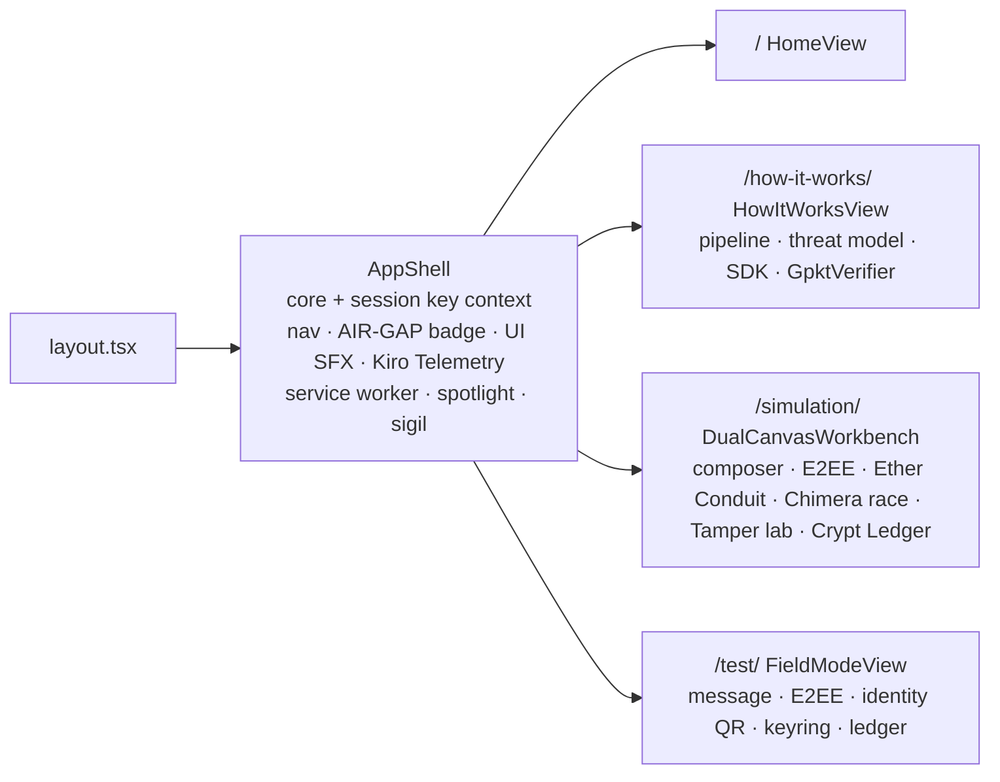

# Design — GhostPacket platform V2

## Site

`next.config.ts`: `output: "export"`, `trailingSlash: true`. `scripts/fix-next-export.mjs` (run by `npm run build`) copies Next 16's nested prefetch files `__next.<seg>/__PAGE__.txt` to the flat names the router requests (`__next.<seg>.__PAGE__.txt`); without it GitHub Pages answers 404 on every prefetch.

## Encryption (`crates/ghostpacket-core/src/encryption.rs`)
```text
payload (FLAG_ENCRYPTED 0x10) = [salt 16][ChaCha20-Poly1305 ciphertext of (postcard | LZ4 block)][tag 16]
key ‖ nonce = PBKDF2-HMAC-SHA256(NFC(passphrase), salt, 40 000) → 32 + 12 bytes
AAD = frame[0..8] (preamble, version, flags, length)
```
- The salt comes from `crypto.getRandomValues` for every frame: key and nonce change together, so a nonce never repeats under a key.
- Verification order: size → preamble → version/flags → length → CRC32 → **decrypt** → bounded LZ4 → schema → keyring → strict Ed25519.
- Cost (measured): 89 ms seal, 90 ms open in WASM on a desktop; native release 58/54 ms. 40 000 iterations is a deliberate trade-off: every encrypted frame is broadcast, so guesses are offline; OWASP's 600 000 would take seconds on a phone. The UI warns about passphrases under three words.
- A receiver forced to run PBKDF2 by junk encrypted frames is bounded by the CRC32 check (cheap) and by the receiver only verifying newly decoded frames.
- `Material` (key, nonce) and decrypted buffers are `zeroize`d on drop.

## Custom message bounds
Worst case (incompressible text at every bound, 10-byte timestamp varint) = 403 B serialized → 435 B encrypted payload → 511 B frame (`largest_encrypted_custom_message_fits_512_bytes`). A 64-byte title overshot by 3 bytes, hence 60.

## Ledger and keyring (localStorage, public data only)
| Store | Key | Content |
|---|---|---|
| `ghostpacket.ledger.v1.sim` / `.field` | `fingerprint/docId/timestamp` | doc type label, channel, first seen, times seen; never message text or decrypted content |
| `ghostpacket.keyring.v1` | public key hex | label (≤ 32 chars), fingerprint, added at |

The signing key is never stored. Identity QR: `GPKT-KEY:<label>:<64 hex>` in QR byte mode; the key is validated by `fingerprint_of` (WASM, Ed25519 point check).

## Tamper lab (`lib/tamper-lab.ts`)
Layers in order: Structure, CRC32, ChaCha20-Poly1305 (if encrypted), LZ4 + schema, Keyring (if strict), Ed25519. The error code maps to the layer that failed; earlier layers pass, later ones are skipped.

## Chimera race (`lib/chimera.ts`)
Both loopbacks run concurrently. Sabotage is read live: the jammer adds noise at −25 dB SNR to the rest of the burst (a −10 dB jammer was still decoded thanks to the Goertzel processing gain), "block camera" raises the loss to 85 %. Each race draws a fresh loss pattern; with 85 % loss light usually loses (≈ 160 frames needed at 12 FPS), and when it still wins the summary says so.

## Field fixes
- Squelch: adaptive floor (fast fall, slow rise 0.9995/chunk, initial value ≤ 0.002 RMS); a chunk 1.6× above the floor is loud; the demodulator only runs while a loud chunk is still in the ring buffer.
- 88.2/96/192 kHz devices: box decimation to ≤ 48 kHz on capture; playback synthesized at ≤ 48 kHz in an AudioBuffer of that rate. Ring length is capped at `MAX_SAMPLES`. Errors other than "no preamble / too short" are shown, never masked as "listening".
- `DROPLET_SESSION_MISMATCH` inside `CameraScanner`: reset and re-ingest the same droplet.

## Validation (headless Chrome, base path `/GhostPacket/`, fake microphone and camera)
26 checks: four pages render; home CTA demo in 14.4 s; custom message + E2EE over QR decrypted; ENC label; four tamper attacks with the expected codes; curse byte #0 → Structure; Blood Moon; replay detected; race (jammed audio → light wins; blocked camera → sound wins); `.gpkt` verifier; field microphone and camera verified; service worker controls the page; offline reload works with the OFFLINE badge; 0 console error, 0 external request, 0 404.

## Independent review
`dsp-security-auditor` (`.kiro/agents/`) reviewed the V2 code before release. Fixed from its report: decrypted titles stored in the ledger, mic failing above ~50 kHz, iteration count raised from 20 000 to 40 000, keys/plaintext zeroized, NFC passphrases, empty-passphrase fallback to plaintext, keyring list bounded before conversion, service worker offline fallback, squelch initial floor, ledger key collisions.
