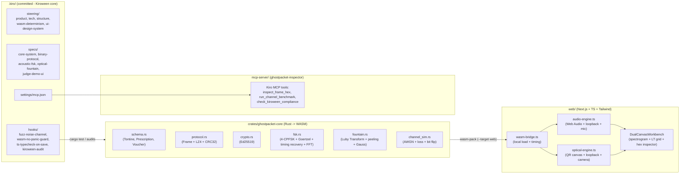

# Detailed Implementation Plan — GhostPacket (Kiroween 2026)

> **Kiroween alignment**: this plan is built around the 3 official, equally weighted criteria (**Potential Value**, **Implementation / Kiro Usage**, **Quality & Design**) and respects the elimination rule: **the `.kiro/` folder is complete, active and committed to Git**, while `.gitignore` strictly excludes any trace of external tools other than Kiro.
>
> **Status (2026-11-24)**: phases 0 to 5 are done, phase 6 is partly done. Each phase below shows what was delivered and how it was verified. Measured numbers replace the initial estimates.

---

## 1. Kiroween positioning & brief summary

Analysis of the source brief [ghostpacket.md](./ghostpacket.md):

| Axis | Decision | Kiroween rationale |
|---|---|---|
| **Main category** | **Frankenstein** | Fuses 3 unrelated disciplines in a backend-free browser: **Rust → WASM crypto/compression**, **acoustic FSK DSP (Web Audio API)** and **optical Luby Transform fountain codes (Canvas/camera)**. |
| **Secondary fit** | **Resurrection** / **Costume Contest** | Brings the 1980s acoustic FSK modem back for the Ed25519 era; dark, phosphorescent, oscilloscope-like "Spectral Signal Lab" UI true to the *GhostPacket* name. |
| **US-02 clarification** | Strict binary bound `≤ 512 bytes` | The draft in `ghostpacket.md` mentioned a generic USSD note (160 bytes). For GhostPacket, `.kiro/specs/core-system/requirements.md` sets a strict physical bound: **compressed payload target 150–300 bytes**, **complete binary frame ≤ 512 bytes**. |
| **Judge demo** | **< 30 seconds, 1 click, zero setup** | *Dual-Canvas* mode with a built-in virtual audio/optical loopback (works even without microphone/camera permission) + **real field mode (PC ↔ phone)** for the 3-minute video. |
| **Language** | **English everywhere a judge looks** | UI, WASM error messages, `.kiro/`, README and these docs. Presets keep authentic Senegalese place and person names. |

---

## 2. Environment diagnosis

| Tool | Initial state | Action taken |
|---|---|---|
| `git` | `2.55.0.windows.3`, repository not initialized | `git init -b main` ✅ |
| `node` / `npm` | `v24.18.0` / `11.16.0` | Used for Next.js and the MCP server (native TypeScript type stripping) ✅ |
| `rustc` / `cargo` | `1.97.1` | Ready for `crates/ghostpacket-core` ✅ |
| `wasm32-unknown-unknown` target | **Not installed** | `rustup target add wasm32-unknown-unknown` ✅ (slow download, ~25 KB/s) |
| `wasm-pack` | **Not installed** | Official binary `v0.15.1` installed in `~/.cargo/bin` ✅ |
| `.gitignore` | Created | `.kiro/` forced visible; all external tools ignored ✅ |

---

## 3. Overall repository architecture



### Repository tree (as built)

```text
GhostPacket/
├── .gitignore
├── .github/workflows/pages.yml              # Optional manual Actions deployment to GitHub Pages
├── IMPLEMENTATION_PLAN.md                   # This plan
├── LICENSE                                  # MIT (required by Devpost)
├── README.md                                # Architecture, demo, Kiro workflow
├── UI_DESIGN_GUIDELINES.md                  # "Spectral Telemetry" art direction
├── ghostpacket.md                           # Original brief
├── .kiro/
│   ├── steering/                            # product, tech, structure (always), wasm-determinism, ui-design-system (fileMatch)
│   ├── specs/<5 specs>/                     # requirements.md (EARS), design.md, tasks.md
│   ├── hooks/                               # 4 v1 hooks
│   └── settings/mcp.json                    # Local MCP server declaration
├── crates/ghostpacket-core/
│   ├── Cargo.toml
│   ├── src/{lib,error,schema,protocol,crypto,fec,fsk,fountain,channel_sim}.rs
│   └── tests/{protocol_vectors,noise_fsk_fuzz,optical_fountain_fuzz}.rs + common/mod.rs
├── mcp-server/
│   ├── package.json
│   └── src/{index,core,smoke}.ts            # stdio MCP server, run by Node directly
├── scripts/{no-panic-guard,kiroween-audit,copy-wasm,deploy-gh-pages}.mjs
└── web/
    ├── package.json, next.config.ts, tsconfig.json, postcss.config.mjs
    ├── public/{manifest.json, icon.svg, wasm/, worklets/capture-processor.js}
    └── src/
        ├── app/{layout.tsx, page.tsx, globals.css}
        ├── lib/{types,presets,wasm-bridge,audio-engine,optical-engine,demo-runner}.ts
        ├── components/{GhostPacketApp, JudgeQuickDemoBar, DualCanvasWorkbench, PayloadComposer,
        │               ChannelControls, SpectrogramCanvas, FountainGridCanvas, ResultCard,
        │               FrameInspector, FieldModeView}.tsx
        └── wasm/                            # wasm-pack output (committed)
```

Tailwind v4 is configured in CSS (`@theme` in `globals.css`), so there is no `tailwind.config.ts`.

---

## 4. Exact technical specifications (bit & algorithm level)

The authoritative versions, with measured results, are in `.kiro/specs/*/design.md`. Summary:

### 4.1 Binary protocol (`binary-protocol`)

Exact **big-endian** layout:

```text
Offset   Size     Field              Description
------------------------------------------------------------------------------------
0        4 B      Sync preamble      Fixed magic: 0x47 0x50 0x4B 0x54 ("GPKT")
4        1 B      Version            0x01 (any other version => UNSUPPORTED_VERSION)
5        1 B      Flags              Bit 0: LZ4 | Bit 1: FSK | Bit 2: Fountain | Bit 3: Demo | Bits 4..7 reserved (0)
6        2 B      Payload length     u16 BE = N (1 <= N <= 436)
8        N B      Payload            postcard document, LZ4 block if bit 0 (decompressed size bounded to 4096 B)
8+N      4 B      CRC32              u32 BE = crc32fast(frame[0 .. 8+N])
12+N     64 B     Ed25519 signature  Signature over frame[0 .. 12+N] (header + payload + CRC32)
------------------------------------------------------------------------------------
Total: 76 + N bytes (strictly <= 512 bytes)
```

- **Compact payload** (`schema.rs`): canonical `postcard` + `serde` encoding of a `GhostDocument { doc_type, doc_id: [u8; 8], timestamp: u64, issuer_pubkey: [u8; 32], fields }`. Measured: 220 / 274 / 235 bytes for the three presets, frames of 296 / 350 / 311 bytes. LZ4 is kept only when it shrinks the payload; on these texts it does not.
- **LZ4 bomb protection**: `MAX_DECOMPRESSED_BYTES = 4096` is checked before any allocation.
- **Verification order**: size → preamble → version/flags → length → **CRC32 (`CRC32_MISMATCH`)** → bounded LZ4 → schema → keyring (`UNTRUSTED_ISSUER`) → **strict Ed25519 (`INVALID_SIGNATURE`)**.

### 4.2 Channel A — 4-FSK acoustic modem (`acoustic-fsk`)

| Parameter | Field mode (robust) | Fast demo mode (Dual-Canvas) |
|---|---|---|
| Sample rate | Taken from the `AudioContext` (8–192 kHz) | 48000 Hz |
| Modulation | **Continuous-phase 4-FSK**, 2 bits/symbol, Gray coded | same |
| Data carriers | 1600 / 2000 / 2400 / 2800 Hz | same |
| Sync carriers | 1200 / 3200 Hz (Barker-13 + 3 guard symbols) | same |
| Symbol duration | 15 ms (133 bit/s) | 6 ms (333 bit/s) |
| Envelope | Raised-cosine ramp on the first and last symbol | same |
| FEC | **Reed-Solomon GF(256)**, 16 parity bytes per ≤ 239-byte block | same |
| Burst, 296 B frame | ≈ 20.3 s | ≈ 8.1 s |

Demodulation: two-pass Barker preamble search on the Goertzel 3200/1200 Hz contrast, centred-window symbol decisions, **early-late symbol timing recovery** (added after an "air" test showed failures from ±100 ppm clock drift with echo), Reed-Solomon correction, `FSK_INCOMPLETE` state for a live `SYNC LOCK`, and a 1024-point Hann FFT for the spectrogram.

### 4.3 Channel B — fountain-coded optical stream (`optical-fountain`)

- **Split**: the frame is zero-padded to 16-byte blocks: K = 19 / 22 / 20 for the presets (K ≤ 64).
- **Droplet**: `[GQ 2B][Session 2B][K 1B][BlockSize 1B][TotalLen 2B][Seed 4B][XOR data 16B][CRC16 2B]` = **30 bytes** = 60 uppercase hex characters = **QR version 3-M (29×29)**.
- **PRNG**: `xorshift64*` seeded by splitmix64, bounded draws on the **high 32 bits** (the low bits left one block uncovered on some sessions: bug found by the fuzz test).
- **Degree distribution**: 20 % d=1, 35 % d=2, 20 % d=3, 25 % dense d ∈ [max(4, K/3), max(4, K/2)]. The initial 25/45/20/10 plan needed ≈ 1.47 K received droplets and failed on some seeds; the dense spike brings it to ≈ 1.23 K.
- **Decoder**: peeling (belief propagation) with cascade reporting, plus **Gauss-Jordan elimination over GF(2)** when peeling stalls.
- **Resilience (measured)**: 100 % of 100 seeds rebuilt at 30, 40 and 50 % loss; ≈ 35 images shown on average at 30 % loss, so about 3 s at 12 FPS.

---

## 5. Complete Kiro configuration (`.kiro/` & MCP)

### 5.1 Steering docs (`.kiro/steering/`)
1. `product.md` (`inclusion: always`): offline air-gap problem, personas, the **30-second** hardware-free demo rule, English-everywhere rule.
2. `tech.md` (`inclusion: always`): Rust stack (`wasm32-unknown-unknown`, `wasm-pack --target web`), Next.js App Router, strict TypeScript, Web Audio API, Canvas 2D, budgets, zero client secret.
3. `structure.md` (`inclusion: always`): crypto, compression, FSK DSP and LT fountain logic live only in `crates/ghostpacket-core`; `web/` only handles hardware I/O, UI state and Canvas rendering.
4. `wasm-determinism.md` (`inclusion: fileMatch`, `crates/**/*.rs`): no `unwrap`/`expect`/`panic!`, no implicit randomness or time, bounded allocations, size-optimized release profile.
5. `ui-design-system.md` (`inclusion: fileMatch`, `web/src/**`): "Spectral Telemetry" tokens and rules, linked to `UI_DESIGN_GUIDELINES.md`.

### 5.2 Kiro specs (`.kiro/specs/`)
Each folder holds `requirements.md` (**EARS**: `WHEN … THE SYSTEM SHALL …`, `IF … THEN …`, `WHILE …`), `design.md` (architecture, Mermaid diagrams, measured results) and `tasks.md` (checkable tasks with requirement references): `core-system`, `binary-protocol`, `acoustic-fsk`, `optical-fountain`, `judge-demo-ui`.

### 5.3 Agent hooks (`.kiro/hooks/*.json`, v1 format)
1. **`fuzz-noise-channel.json`** (`PostFileSave`, Rust `src/`): runs the acoustic and optical fuzz suites.
2. **`wasm-no-panic-guard.json`** (`PostFileSave`, Rust `src/`): static check rejecting forbidden calls outside `#[cfg(test)]`.
3. **`ts-typecheck-on-save.json`** (`PostFileSave`, `web/src/**/*.ts(x)`): `npm --prefix web run typecheck`.
4. **`kiroween-audit.json`** (`Stop`): `.kiro/` tracked, no secret, licence, zero panic, WASM size, full Rust suite and type check. (The initial plan said `AgentStop`; the v1 trigger is `Stop`.)

### 5.4 MCP integration (`.kiro/settings/mcp.json` + `mcp-server/`)
Local TypeScript MCP server `ghostpacket-inspector` (stdio) that loads **the same `.wasm` binary as the browser** and exposes:
- `inspect_frame_hex(hex | sample)`: decodes a raw frame into JSON (fields, flags, CRC32 validity, Ed25519 result, document).
- `run_channel_benchmark(snr_db, drop_rate_pct, iterations, preset)`: deterministic stress test of both channels with success rates and latencies.
- `check_kiroween_compliance(full)`: runs `scripts/kiroween-audit.mjs`.

The server reads the WASM and presets once at start-up: reconnect it in Kiro after rebuilding the WASM or editing presets.

---

## 6. Phased implementation plan

### Phase 0 — Initialization & repository hygiene ✅
- [x] Create `.gitignore` (`.kiro/` explicitly included, other external tools excluded).
- [x] Install the WASM target and `wasm-pack`.
- [x] `git init -b main`, add the MIT `LICENSE`.

### Phase 1 — Kiro-first foundation (`.kiro/` + MCP) ✅
- [x] 5 steering docs, 5 complete specs, 4 hooks.
- [x] `.kiro/settings/mcp.json` (copied by the user: Kiro does not let agents write `.kiro/settings/`).
- [x] JSON and YAML front matter validated by the audit script.

### Phase 2 — Rust cryptographic core & binary protocol ✅
- [x] `Cargo.toml` with pure-Rust, WASM-friendly crates (`getrandom` dropped: seeds come from the caller).
- [x] `error.rs`, `schema.rs`, `crypto.rs`, `protocol.rs`.
- [x] `tests/protocol_vectors.rs`: round-trips, 150–300 B payloads, every single-bit flip rejected, structural codes, LZ4 bomb, keyring.

### Phase 3 — Channel A (FSK + FEC) & channel B (LT fountain) ✅
- [x] `fec.rs`, `fsk.rs` (with timing recovery), `fountain.rs` (with Gauss fallback), `channel_sim.rs`.
- [x] `tests/noise_fsk_fuzz.rs`: 100 % at 6–20 dB, ±300 ppm drift and room echo; `tests/optical_fountain_fuzz.rs`: 100 % at 30/40/50 % loss on 100 seeds.
- [x] WASM build: ≈ 241 KB gzip (budget 350 KB).

### Phase 4 — Local MCP server ✅
- [x] `mcp-server/src/index.ts` with `@modelcontextprotocol/sdk`, 3 tools.
- [x] Tested over a real stdio handshake and from Kiro itself.

### Phase 5 — "Spectral Signal Lab" Dual-Canvas UI ✅
- [x] Next.js static export, strict TypeScript, Tailwind v4, self-hosted fonts.
- [x] `wasm-bridge.ts`, `audio-engine.ts`, `optical-engine.ts`, `demo-runner.ts`.
- [x] Judge bar, emitter, channel and receiver columns, frame inspector, field mode with automatic fallback.
- [x] English copy throughout.

### Phase 6 — End-to-end verification, deployment & submission (in progress)
- [x] All automated tests (38 Rust tests incl. fuzzing, TypeScript, Next.js production build).
- [x] Headless Chrome: 1-click demo in ≈ 14 s, 0 console error, 0 external request.
- [x] Headless Chrome field receiver with fake microphone (drift + echo + noise → verified at 26.3 s) and fake camera (blurred QR → 20/20 blocks in 3.6 s).
- [x] Deployment to GitHub Pages from the `gh-pages` branch (`scripts/deploy-gh-pages.mjs`; the Actions workflow is kept as a manual alternative because the account's Actions jobs were blocked by billing).
- [x] Live at **https://arthurnsongan.github.io/GhostPacket/**, checked in headless Chrome: 1-click demo in 12.9 s, field receiver verified over fake microphone and fake camera, 0 console error, 0 request outside the Pages origin.
- [ ] **Physical PC ↔ phone test** (sound + camera QR) to capture the video proof — see the README "Field test" section.
- [ ] 3-minute video and Devpost form.

#### 3:00 video script
- `0:00 – 0:30`: the air-gap problem (rural clinics, tontines, off-grid areas) and the *GhostPacket* chimera.
- `0:30 – 1:20`: live 1-click *Dual-Canvas* demo (signature + FSK spectrogram with noise + fountain QR with 30 % loss + instant rejection of a 1-bit curse).
- `1:20 – 2:10`: **real computer ↔ phone proof** (phone in airplane mode: acoustic then optical QR transmission, no Wi-Fi, no Bluetooth).
- `2:10 – 2:50`: inside `.kiro/` (EARS specs, `wasm-determinism.md` steering, `fuzz-noise-channel` hook in action, `ghostpacket-inspector` MCP).
- `2:50 – 3:00`: conclusion, public URL and open-source repository.

---

## 7. Verification plan & acceptance criteria

| Criterion | Verification method | Target | Result |
|---|---|---|---|
| **Git & Kiroween hygiene** | `git status --ignored` + `kiroween-audit` | `.kiro/` 100 % tracked; 0 external tool file | ✅ |
| **Zero WASM panic** | `wasm-no-panic-guard` hook + `cargo clippy -- -D warnings` | 0 `.unwrap()`, 0 `.expect()`, 0 `panic!()` in `src/` | ✅ |
| **Physical bounds (US-02)** | `cargo test --test protocol_vectors` | Frame ≤ 512 B, presets 150–300 B | ✅ 220–274 B payloads |
| **Cryptographic integrity (US-03)** | Unit test + "Curse 1 bit" button | 100 % rejection (`CRC32_MISMATCH` or `INVALID_SIGNATURE`) | ✅ every bit of every preset |
| **Noise & 30 % loss resilience** | `fuzz-noise-channel` hook | 100 % FSK at SNR ≥ 10 dB; 100 % LT at 30 % loss | ✅ also 6 dB, ±300 ppm, 50 % loss |
| **Local performance (< 500 ms)** | Timing in `wasm-bridge.ts` | Encode/verify < 15 ms, FFT < 5 ms | ✅ ≈ 1 ms / 0.5–0.7 ms |
| **Judge path (< 30 s, US-01)** | Headless Chrome | 1-click scenario with no mic/camera | ✅ ≈ 14 s |
| **Zero client secret** | `kiroween-audit` + bundle inspection | 0 API key, 0 external network call | ✅ |
| **Real air path** | Physical PC ↔ phone test | Verified frame over sound and over QR | ⏳ to do |
